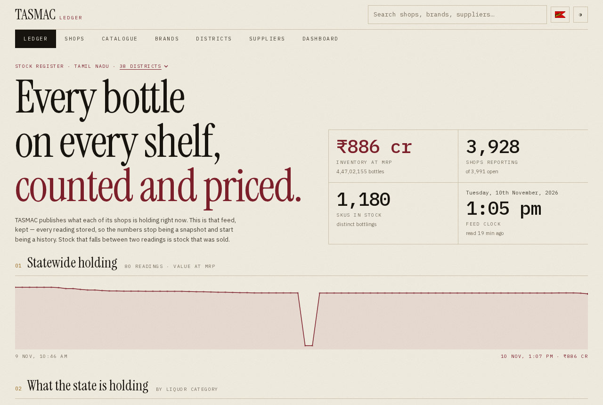
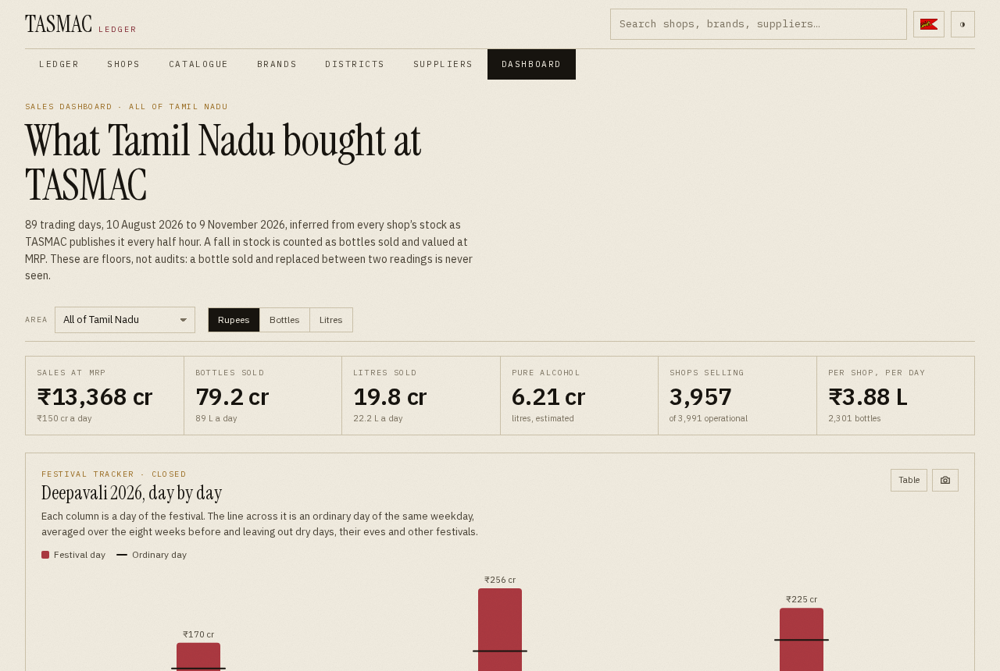
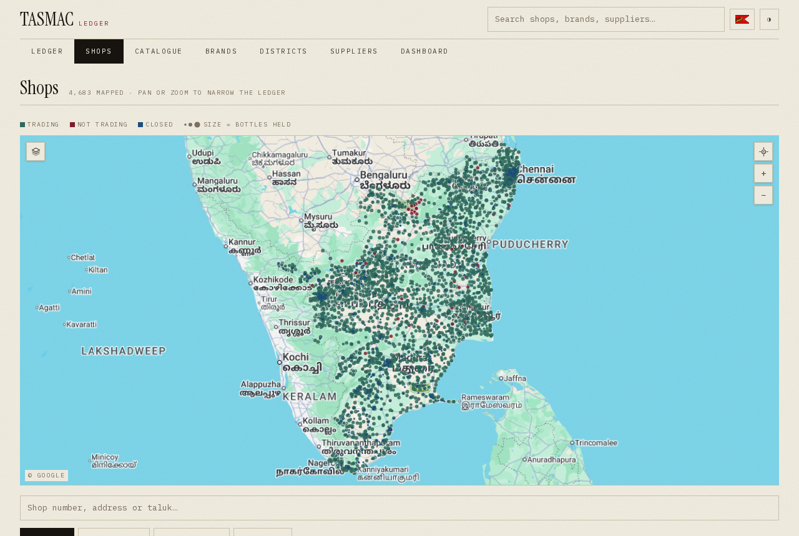
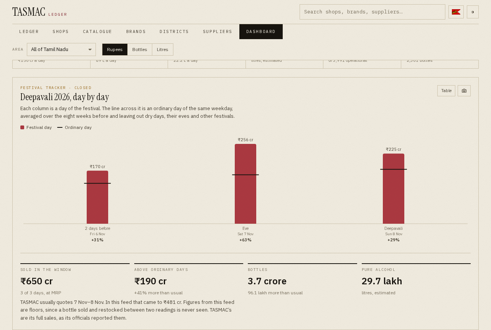
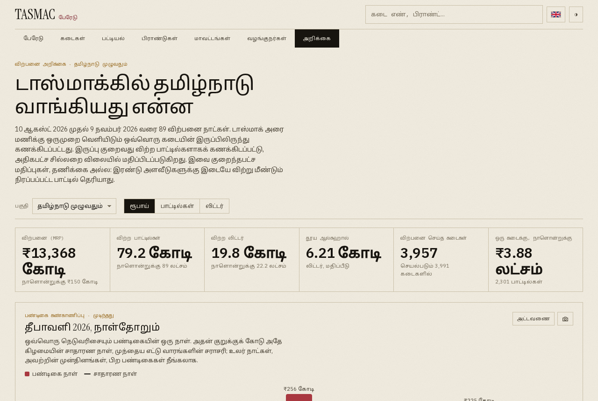
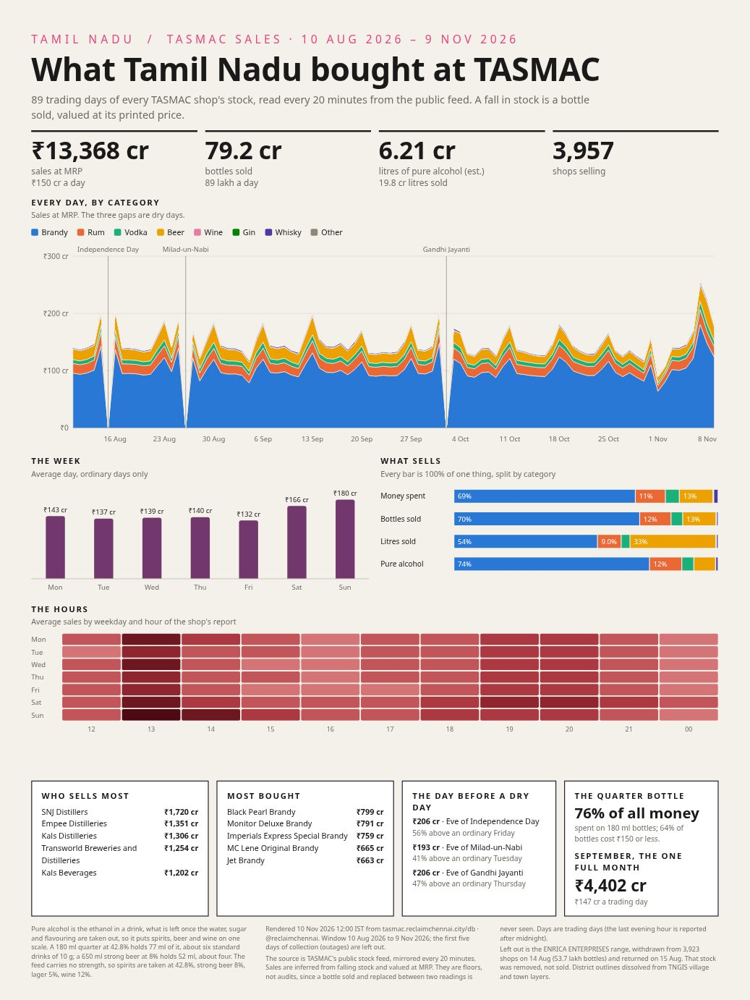
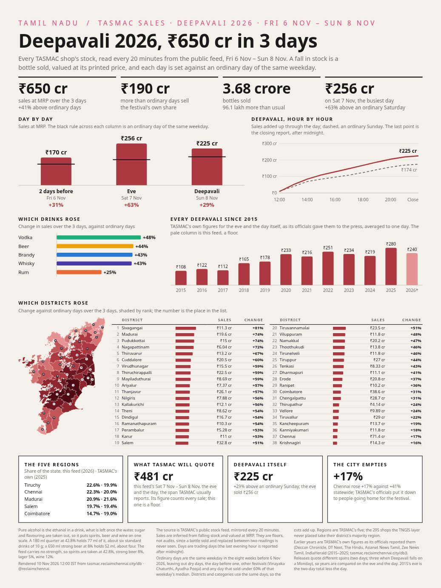
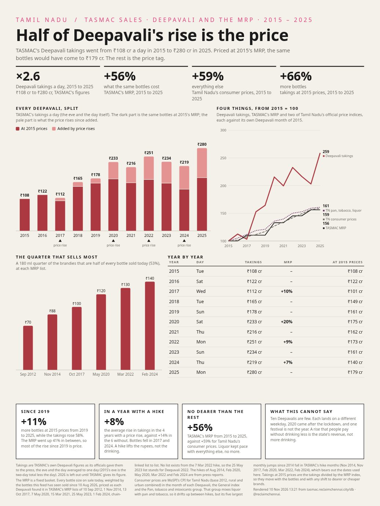

# TASMAC Ledger

Every bottle on every TASMAC shelf in Tamil Nadu, counted every 20 minutes, kept as a history.

TASMAC runs all of Tamil Nadu's liquor shops. Its public website shows what each shop is holding right now, and nothing else. This project reads that feed for all shops every 20 minutes and keeps every reading. When stock falls between two readings, that stock was sold. So a live snapshot becomes a history of sales, shop by shop and bottle by bottle.

The site is at [tasmac.reclaimchennai.city](https://tasmac.reclaimchennai.city), in English and Tamil. Made by [Reclaim Chennai](https://reclaimchennai.city). Not linked to TASMAC or the Government of Tamil Nadu.



## What is in this repository

| Folder | What it holds |
| --- | --- |
| [`opendata/`](opendata/README.md) | The open data as plain CSV files. Prices since 2012, the catalogue, every shop, and daily sales |
| `src/` | The website (Next.js), the scraper that reads TASMAC's feed, and a Telegram bot |
| `posters/` | Printable posters made from the data, in English and Tamil |
| `scripts/` | Small tools, including the one that writes `opendata/` |
| `docs/screenshots/` | The pictures in this file |
| [Releases](https://github.com/reclaimchennai/tasmac-ledger/releases) | The large files. The full database, sales by shop, the original price list PDFs and the posters |

## The data in short

| | |
| --- | --- |
| Shops | 4,871 shops ever seen, about 3,990 open today, 717 closed by government order in 2026 |
| Catalogue | 2,616 bottlings from 141 suppliers |
| Prices | 6,860 price records for 2,595 bottlings, from TASMAC price lists of 2012, 2014, 2017, 2020, 2021, 2023, 2024 and 2025, and the live feed since August 2026 |
| Sales | 92 days from 10 Aug 2026, about ₹13,370 crore and 79 crore bottles at MRP |
| Raw readings | 6.25 crore stock changes and 2.5 crore shop reports, in the full database |

Start with [`opendata/sales/daily_summary.csv`](opendata/sales/daily_summary.csv). It has one row per day with bottles, rupees, litres, pure alcohol and the number of shops that sold.

## What the site shows

The dashboard has daily sales for the state or any district, by drink, brand, distillery, bottle size, price and hour.



Every shop is on a map, coloured by whether it is trading.



A festival tracker compares each festival day with an ordinary day of the same weekday, and with what TASMAC itself reported in earlier years.



The whole site is also in Tamil.



## Posters

Posters are drawn from the data every day, in English and Tamil, as PNG and PDF. The latest are on the site and in the releases.

| | | |
| --- | --- | --- |
|  |  |  |
| What Tamil Nadu bought | Deepavali 2026, day by day | Half of Deepavali's rise is the price |

The last one asks whether price rises explain the growth in Deepavali sales. TASMAC's Deepavali takings went from ₹108 crore a day in 2015 to ₹280 crore in 2025. Over the same years the same bottles got 56% dearer, close to the 59% rise in Tamil Nadu's consumer prices. So about half of the rise is price, and since 2019 almost all of it is. In years with a price rise, sales grew less, not more.

## Things to know about the numbers

**Sales are a floor.** A bottle that is sold and restocked between two readings is never seen. So every sales figure here is a little lower than the real one. TASMAC's own figures, where it gives them, are its full sales.

**Money is at MRP.** Rupees are the printed shelf price, so they are what buyers paid, not TASMAC's income.

**A trading day ends after midnight.** Shops close at 10 pm and the last report of the day reaches the feed after midnight. So a day here runs from 11 am to 11 am the next day.

**The feed goes blank around midnight.** For about 40 minutes after midnight the feed returns no shops. This happens every night and is not a fault.

**Brands are spelt many ways.** The feed has "KING FISHER" and "KINGFISHER" as two brands, and a few names with broken characters. The feed is never edited. A reviewed list of correct spellings in `src/lib/name-rules.ts` is applied on top.

**Tamil names are made here.** The feed is English only. District names are written by hand, and brand and place names are written in Tamil script by rule, then reviewed.

**One range is left out.** On 14 Aug 2026 the ENRICA ENTERPRISES range was taken off 3,923 shops and put back the next day. That was stock moved, not sold, so it is not counted.

## Where the data comes from

| Source | Used for |
| --- | --- |
| TASMAC's public stock feed, behind [tasmac.tn.gov.in](https://tasmac.tn.gov.in) | Shops, stock, live prices, the catalogue |
| TASMAC price lists, 2012 to 2026 | Price history. The PDFs are in the releases. The 2012 list came from a web archive and the 2014 list from a blog that copied it |
| [TNGIS](https://tngis.tn.gov.in), the state map server | TASMAC regions, shop locations and offices |
| Government order on the 2026 shop closures | Which shops closed, and when |
| News reports quoting TASMAC officials | Deepavali sales from 2015 to 2025, with links in `src/data/festivals.json` |
| MoSPI consumer price index for Tamil Nadu | Prices in general, for the Deepavali poster |
| Population projections (2020) and NFHS 6 | People and drinking by district, for the per person figures |

## Run it yourself

You need Node 24, the version the Docker image uses.

```bash
npm install
cp .env.example .env.local      # only needed for the Telegram bot
npm run harvest:all             # shops, catalogue and a first stock reading, about 2 minutes
npm run harvest:gis             # regions and shop locations from TNGIS
npm run dev                     # the site, on port 3000
npm run watch                   # keep reading the feed every 20 minutes
```

Or with Docker, which runs the site and the scraper together. The compose file joins a shared network called `web`, so create it once.

```bash
docker network create web
docker compose up -d tasmac-site tasmac-watch
```

To start from the published history instead of an empty database, download the database parts from the releases and join them.

```bash
cat tasmac.db.zst.part* | zstd -d -o data/tasmac.db
```

To rebuild the open data and the posters from the database.

```bash
python3 scripts/export-open-data.py
python3 posters/render.py
```

The full database layout is in [`src/lib/schema.sql`](src/lib/schema.sql).

## Using this

Code is under the MIT licence. The data comes from public government sources, so please credit TASMAC, TNGIS and MoSPI as the original publishers, and this project for the collection. How to cite it is in [`CITATION.cff`](CITATION.cff). Corrections are welcome as issues.
